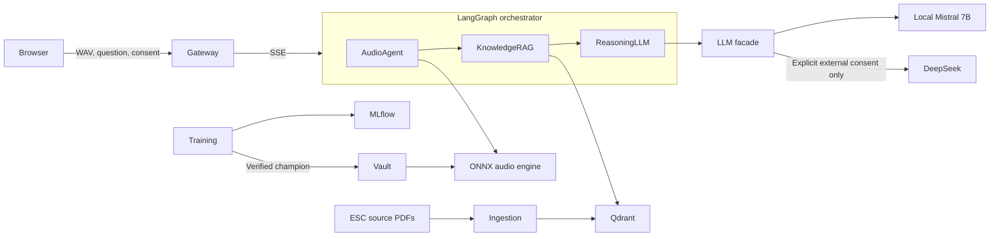

# CardioAgent-Ops

An ENSIT cardio-acoustic **research** platform: reproducible audio-model tuning,
MLflow governance, ONNX inference, Qdrant evidence retrieval, and three specialized
LangGraph agents behind a streaming FastAPI workbench.

**Not a medical device.** A normal/abnormal acoustic classification cannot diagnose
or exclude disease. Do not upload patient identifiers.

## Architecture



Six Compose services: `api-gateway` (8000), `agent-orchestrator` (8003),
`audio-engine` (8002), `llm-server` (8001), `vector-db` (6333), `mlflow-server`
(5000). Ollama runs on the host, reusing existing weights. All published ports
bind to **127.0.0.1**. The frontend is served by the gateway, not a seventh service.
The LLM facade is not itself an Ollama runtime; this is a deliberate adaptation
of the PDF to the existing local installation and DeepSeek support.

### Specification decisions

- All five required audio families are implemented: Decision Tree, RBF SVM,
  custom CNN, **Keras Applications ResNet50/ImageNet**, and Transformer–CNN.
- “Fine-tuning” means **audio hyperparameter tuning and ResNet backbone
  adaptation**, per the user's clarification. LLM weights are **not fine-tuned**.
  The PDF explicitly requires QLoRA/GGUF; this is a documented submission
  deviation, not something satisfied by prompting or RAG.
- Three graph agents: acoustic analyst, evidence researcher, reasoning LLM.
  A deterministic schema/citation/safety auditor is part of the last node, not
  an extra autonomous agent.
- Champion maximizes validation pathological recall **subject to specificity
  ≥0.5**, then specificity and AUPRC break ties. The gate prevents an all-positive
  classifier “winning” on recall alone. It is a research acceptance rule, not
  clinical validation.
- No synthetic fallback models, fake scores, invented citations, or silent
  provider switches. Missing model/index/provider means unavailable or abstention.

## Quick start

Requires Docker Compose, uv, Python 3.12+, the two licensed original datasets,
and a running local Ollama with `mistral:7b-instruct`.

```bash
uv sync --locked --dev
uv run python scripts/init_vault.py
# On non-1000 UID/GID hosts, set LOCAL_UID/LOCAL_GID in .env to `id -u`/`id -g`.
docker compose up --build -d
```

Open <http://localhost:8000>. Liveness can be green before an artifact or index
is available; the workbench's **Check services** uses readiness, not just liveness.
On a fresh checkout, train a model and index the corpus before analysis.

The completed five-model CPU comparison and verification limits are recorded in
[`results/README.md`](results/README.md), with machine-readable metrics in
`results/five-model-benchmark.json`. These are research results, not medical readiness.

For the evaluation, read the [ten-page oral-defense guide](docs/CardioAgent-Ops-Defense-Guide.pdf):
architecture, model choices, real metrics, signal/window versus PDF chunking,
MLOps, a live demo runbook, limitations and rehearsal questions.
Rebuild it from its source with:

```bash
uv run --locked --group docs python docs/build_defense_guide.py
```

The initializer never overwrites `.env`. The example contains no key. Set keys
only in your existing local `.env`. Do not publish `.env`, datasets, recordings,
weights, or the vault.

Python service images export only their role-specific dependency group from
`uv.lock`, verify package hashes, and share a BuildKit download cache. No host
virtualenv is copied. TensorFlow/CUDA are confined to the optional
`deep-learning` training extra, not the inference images.

### Train and deploy

Expected original sources:

```text
datasets/
  PhysioNet/training-*/REFERENCE.csv, REFERENCE-SQI.csv, *.wav
  pascal/set_a.csv, set_b.csv, set_a/*.wav, set_b/*.wav
```

```bash
# Efficient CPU baseline with validation-only hyperparameter tuning:
uv run python -m training.benchmark \
  --models decision_tree svm --trials 6 --activate \
  --tracking-uri http://localhost:5000
docker compose restart audio-engine

# All five models: use the Colab notebook on a GPU runtime:
uv sync --locked --extra deep-learning --dev
uv run --extra deep-learning python -m training.benchmark \
  --epochs 20 --batch-size 16 --trials 6 --activate \
  --tracking-uri http://localhost:5000
```

For a quick smoke experiment add `--max-files 12`; this caps **each
source/class/split**, and the resulting artifact is explicitly marked `subset`.
It is not a final benchmark. The default uses all eligible recordings.
`--min-specificity` controls the documented validation acceptance gate.

Notebooks:

1. `notebooks/01_eda_data_wrangling.ipynb`: source labels, exclusions,
   distribution, group leakage checks, waveform and Mel inspection.
2. `notebooks/02_audio_benchmark.ipynb`: real five-model run, metric comparisons,
   confusion matrices from saved results.
3. `notebooks/03_colab_gpu.ipynb`: Drive datasets, GPU check, uv environment,
   persistent MLflow/vault and downloadable actual artifacts.

Notebooks have no fabricated executed outputs. The Colab notebook clones this
repository, so push current code before running it. Copy downloaded `models/`
and `runs/` into the local vault. Publish the verified artifact to the live
registry and restart inference:

```bash
uv run python -m training.promote vault/models/cardio_model.onnx
docker compose restart audio-engine
```

Passing a model under `vault/runs/` also attaches its complete benchmark report.
Promotion checks hash, feature version, ONNX parity and validation acceptance
before updating the live `CardioAgentAudio@champion` alias. `registry.json` records
the live registry version; a later local activation invalidates that receipt.
Offline training curves remain in their original SQLite/Drive experiment store,
with source run IDs retained in live registry tags. To record all curves directly
on the server, train with `--tracking-uri http://localhost:5000` instead.
Never merge a Colab SQLite database into a running tracking server.

### Index ESC evidence

```bash
uv run python -m rag_engine.ingest --fetch
```

The curated source manifest is `rag_engine/sources.json`. It contains the
**full 102-page 2025 ESC/EACTS professional valvular-disease guideline** and its
patient-facing companion. The original journal URL is retained as the canonical
source; because its download returned HTTP 403 in this environment, the manifest
explicitly uses a public Benha University faculty mirror for the professional PDF.
This is recorded in `download_url`, not silently substituted.
The patient companion is linked by the official
[ESC patient-guidelines page](https://www.escardio.org/guidelines/clinical-practice-guidelines/guidelines-for-patients/).
Respect copyright and local usage requirements; PDFs remain outside Git.
To expand the corpus, supply licensed ESC PDFs plus a JSON manifest mapping each
filename to its original HTTPS `url` and optional HTTPS `download_url`, then use
`--sources your-manifest.json`. Missing or invalid PDFs are not replaced by fake text.

Chunks retain filename, page, original/download URLs, SHA-256 and embedding model.
FastEmbed `BAAI/bge-small-en-v1.5` runs on CPU and caches its weights in the vault;
Qdrant stores cosine vectors. A score threshold filters weak matches; the default
0.55 is an initial setting, **not an empirically optimized retrieval threshold**.
Use an adjudicated retrieval set to tune it before making quality claims.
Document updates should use a new Qdrant collection to avoid retaining old chunks.

### Local and external LLMs

Default: `LLM_PROVIDER=ollama`, `OLLAMA_MODEL=mistral:7b-instruct`.
The local model must really be installed:

```bash
ollama list
curl --fail http://localhost:8001/ready
```

For DeepSeek set `LLM_PROVIDER=deepseek` and `DEEPSEEK_API_KEY` locally, then
recreate `llm-server`. Every analysis also requires explicit external consent
in the UI or `external_consent=true`. Raw audio is never sent to the LLM.
DeepSeek receives derived classifier output and retrieved public guideline
passages only; the free-text question stays local and is used for retrieval.
Local Mistral can also receive the question. There is no silent provider fallback;
Ollama cloud tags and remote aliases are rejected.

On Linux, Docker-to-host Ollama access requires the daemon to listen on an
interface reachable through `host.docker.internal`; its usual loopback-only
binding cannot accept container requests. Prefer a firewall-restricted Docker
bridge interface; do not expose unauthenticated Ollama to the LAN/internet.

## Contracts and research methodology

- Input WAV ≤20 MiB. Decode bounded channels/rates; read the first five seconds,
  mono, DC removal, peak normalization, resample to 2 kHz, pad to five seconds.
  Silence/nonfinite signals fail. The UI caps recordings at 120 seconds.
- Classical input: 40 MFCC means/std + ZCR/RMS means/std = 84 values.
  Scaling lives inside the SVM pipeline and fits training data only.
- Deep input: 96×96 Mel image. CNN learns from scratch; hybrid uses local
  convolution plus temporal self-attention. ResNet converts to RGB, applies
  Keras ResNet preprocessing, warms up a frozen backbone, then fine-tunes only
  its top stage with frozen batch-normalization and a lower learning rate.
- PASCAL `normal`→0; `murmur`, `extrahls`, `extrastole`→1; unlabeled/artifact
  excluded. PhysioNet `REFERENCE.csv` -1→0/+1→1; poor SQI excluded.
- Exact-file duplicates removed before source/class-stratified **group** splitting.
  60/20/20 train/validation/test; PASCAL acquisition IDs and PhysioNet recording
  IDs are grouped. **No verified patient mapping exists here: do not claim
  patient-independent validation.** Identical audio with different headers and
  related recordings without shared IDs remain a leakage risk.
- Class weights affect training only. Validation selects hyperparameters and
  champion; held-out test runs after selection, with no refitting on test.
- Report recall, specificity, precision, F1, AUROC, AUPRC, confusion counts and
  prediction timing. ONNX export must match Python probabilities within `1e-4`
  before activation; SHA-256 and feature version are checked on service startup.
- MLflow nested benchmark/model/trial runs; registered `CardioAgentAudio` model
  with `champion` alias. Inference telemetry contains timing/model identifiers,
  never raw audio, prompts, or full generated reports.
- An auditor verifies schema, retrieved citation IDs, verbatim quote matching,
  and conservative unsafe-language rules. **This does not prove semantic
  entailment or clinical correctness**; a clinician-adjudicated evaluation is
  required. Draft stream tokens are labeled unaudited and are not the final report.

## Vault and operational boundaries

`vault/` centralizes local research state: source documents, manifests,
models, benchmark runs, embedding cache, evaluation reports and exports.
It is a private filesystem workspace, **not HashiCorp Vault**, not encrypted
storage, and not a substitute for secret management. Secrets remain in `.env`.
Compose separately persists Qdrant and MLflow in named volumes.
Back up all three consistently; never commit them.

Only the gateway should be externally exposed behind an authenticated TLS proxy.
`API_KEY` enables gateway authentication via `X-API-Key` or bearer token; the UI
keeps it in memory only. Internal services trust the isolated deployment network;
they are not independently authenticated. This local research configuration is
not hospital production infrastructure. Do not forward internal ports publicly.
The gateway admits at most four analyses per process before parsing uploads;
excess requests receive HTTP 429 with retry guidance. The graph executes at most
two analyses concurrently, with bounded SSE queues and disconnect cancellation.

```bash
curl --fail http://localhost:8000/health
curl http://localhost:8000/status
curl --fail http://localhost:8000/analyze_pcg \
  -F 'file=@path/to/heart.wav' -F 'prompt=Explain relevant evidence'
curl -N http://localhost:8000/analyze_pcg/stream \
  -F 'file=@path/to/heart.wav'
docker compose logs --tail 100
docker compose down
```

`down` preserves data. `down -v` destroys named-volume data; never use it unless
that loss is intended. Model replacement requires audio-engine restart.
MLflow UI: <http://localhost:5000>; Qdrant UI: <http://localhost:6333/dashboard>.

## Evaluation and CI

```bash
uv run python -m pytest --cov=audio_engine --cov=agents --cov=rag_engine \
  --cov=api --cov=training --cov-report=term-missing --cov-report=xml
uv run python -m evaluation.run retrieval vault/evaluations/retrieval.jsonl
uv run python -m evaluation.run reports vault/evaluations/reports.jsonl
```

Retrieval JSONL: `{"query":"...","relevant_ids":["real-qdrant-point-id"]}`.
Report JSONL: `{"result":{...actual-analysis-response...},"expected_abstention":true}`.
Human-adjudicated relevance and independent clinical reviews must be collected,
not invented. Evaluation logs aggregate metrics in MLflow without sensitive
prompts. Retrieval scores Recall@4, Precision@4 and MRR; report evaluation scores
schema, citation/rule compliance and expected abstention. These are not medical
accuracy or semantic-faithfulness metrics.

GitHub Actions tests with measured coverage, validates Compose and builds all six
images; no secrets, weights or Docker images are automatically published.
Automatic retraining/promotion is deliberately not triggered by arbitrary uploads.
Repeated model selection on an exposed test set invalidates the estimate; reserve
a new external validation cohort for final claims.

## Legacy coursework

`TP3.ipynb`, `features.py`, `train_svm.py`, `notebook_correction.py`, and `guide.md`
are earlier coursework/reference material. The active platform uses
`training.benchmark` and `audio_engine.contract`; do not deploy legacy 80-value or
flattened-1200-value artifacts into this versioned 84-value/Mel service.
`/preprocess` retains the legacy demonstration feature summary; `/predict` uses
only the canonical deployed-model contract.
